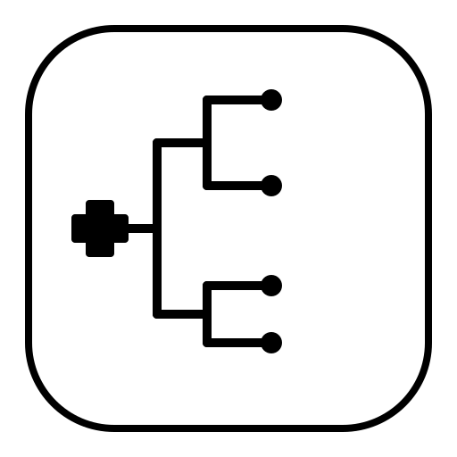
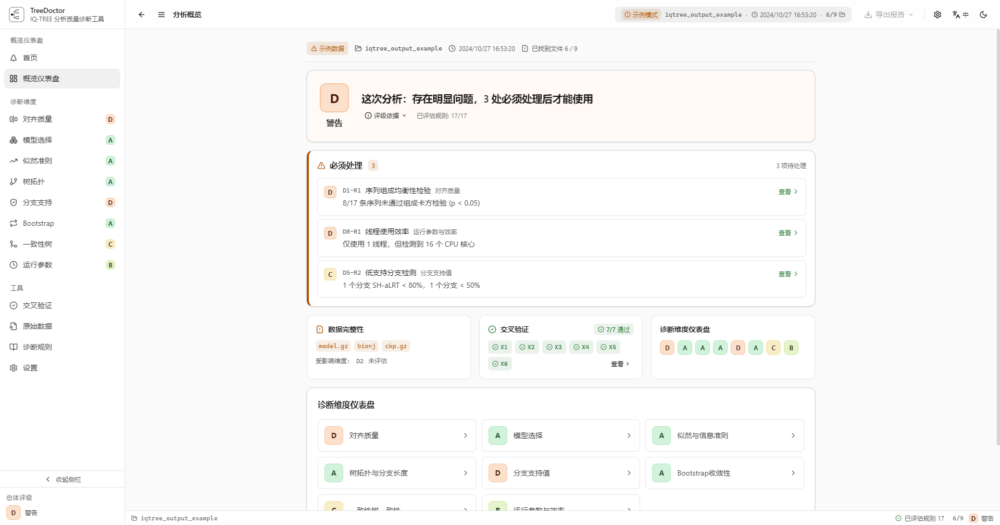

# TreeDoctor

<p align="center">
  
</p>

> IQ-TREE 分析质量诊断工具 | IQ-TREE Analysis Quality Diagnostic Tool

[](LICENSE)
[](#)

---

## 简介 | Introduction

TreeDoctor 是一款专为系统发育学研究者设计的 IQ-TREE 分析质量诊断工具。它能自动解析 IQ-TREE 产生的全部输出文件，进行多维度质量评估和交叉验证，生成清晰、可操作的质量诊断报告。

TreeDoctor is a quality diagnostic tool designed for phylogeneticists using IQ-TREE. It automatically parses all IQ-TREE output files, performs multi-dimensional quality assessment and cross-validation, and generates clear, actionable quality diagnostic reports.

### 功能特点 | Key Features

- **全文件解析** — 自动识别并解析 IQ-TREE 的全部 9 种输出文件类型
  **Full File Parsing** — Automatically recognize and parse all 9 IQ-TREE output file types
- **多维度诊断** — 36 条诊断规则覆盖 8 个质量维度
  **Multi-Dimensional Diagnostics** — 36 diagnostic rules across 8 quality dimensions
- **交叉验证** — 7 条交叉验证规则检查数据一致性
  **Cross-Validation** — 7 cross-validation rules to check data consistency
- **双形态交付** — CLI 命令行 + GUI 桌面应用
  **Dual Interface** — CLI + GUI desktop application
- **版本兼容** — 兼容 IQ-TREE 2.x (v2.4.0) 和 3.x (v3.1.4)
  **Version Compatible** — Compatible with IQ-TREE 2.x (v2.4.0) and 3.x (v3.1.4)
- **多格式输出** — Text / JSON / Markdown / HTML 四种报告格式
  **Multiple Output Formats** — Text / JSON / Markdown / HTML report formats

### 质量维度 | Quality Dimensions

| 质量维度 | 核心问题 | 规则数 |
|----------|----------|--------|
| 对齐质量 (Alignment) | 序列数据本身是否有质量问题？ | 6 |
| 模型选择 (Model Selection) | 替换模型选择是否合理？ | 5 |
| 似然与信息准则 (Likelihood & IC) | 似然值和信息准则是否正常？ | 4 |
| 树拓扑与分支长度 (Topology & Branch Lengths) | 树的形态是否合理？ | 6 |
| 分支支持值 (Branch Support) | 节点支持是否充分？ | 5 |
| Bootstrap 收敛性 (Bootstrap Convergence) | bootstrap 是否充分收敛？ | 4 |
| 一致性树一致性 (Consensus Consistency) | ML 树和一致性树是否一致？ | 3 |
| 运行参数与效率 (Runtime & Efficiency) | 运行配置是否合理？ | 3 |

---

## 界面预览 | Screenshots

<p align="center">
  
  
</p>

<p align="center">
  <sub>GUI 诊断报告 — 分析概览页面（左：浅色主题 | 右：深色主题）<br>
  GUI diagnostic report — Analysis Overview (left: light theme | right: dark theme)</sub>
</p>

---

## 快速开始 | Quick Start

### 下载安装 | Download & Install

前往 [Releases](../../releases) 页面下载最新版本：

Go to the [Releases](../../releases) page to download the latest version:

- **Windows**: `TreeDoctor_0.1.0_x64.exe`（免安装版，双击即可运行）
- **CLI**: `treedoctor.exe`

### 从源码构建 | Build from Source

```bash
# 前提条件 | Prerequisites: Rust 1.75+, Node.js 18+

# 编译 CLI | Build CLI
cargo build --release
# 生成 | Output: target/release/treedoctor.exe

# 编译 GUI | Build GUI
cd gui
npm install
npm run tauri build
# 生成 | Output: target/release/treedoctor-gui.exe
```

### 使用示例 | Usage Examples

**CLI:**

```bash
# 分析 IQ-TREE 输出 | Analyze IQ-TREE output
treedoctor analyze ./test-data/example/

# 生成 JSON 报告 | Generate JSON report
treedoctor analyze ./test-data/example/ -f json -o report.json

# 检查文件完整性 | Check file completeness
treedoctor check ./test-data/example/

# 列出所有诊断规则 | List all diagnostic rules
treedoctor rules
```

**GUI:**

双击运行 `TreeDoctor.exe`，选择 IQ-TREE 输出目录即可。也可直接拖放目录或 `.iqtree` 文件到窗口。

Double-click `TreeDoctor.exe` and select the IQ-TREE output directory. You can also drag and drop a directory or `.iqtree` file onto the window.

---

## 项目结构 | Project Structure

```
TreeDoctor/
├── core/               # Rust 核心库（解析 + 诊断引擎）
├── cli/                # CLI 命令行工具
├── gui/                # Tauri GUI 桌面应用
│   ├── src/            # React 前端源码
│   └── src-tauri/      # Tauri Rust 后端
├── test-data/          # 测试数据（IQ-TREE 输出样本）
├── docs/               # 项目文档
│   ├── zh-CN/          # 中文文档
│   └── en/             # English documentation
├── .github/            # GitHub 配置（Issue 模板等）
├── CONTRIBUTING.md     # 贡献指南
├── LICENSE             # MIT 许可证
└── Cargo.toml          # Rust workspace 配置
```

## 技术栈 | Tech Stack

| 层 | 技术 | 版本 |
|----|------|------|
| 核心引擎 | Rust | 2021 edition, 1.75+ |
| CLI | clap | 4.5 |
| GUI 框架 | Tauri | 2.x |
| 前端框架 | React + TypeScript | 18 + 5 |
| CSS 框架 | TailwindCSS | 3.x |
| 状态管理 | Zustand | 4.x |
| 图表库 | Recharts | 2.x |
| 图标库 | lucide-react | 0.451+ |
| Tauri 插件 | dialog + fs | 2.x |

## 许可证 | License

[MIT License](LICENSE)
